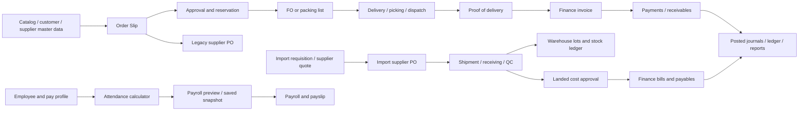

# ERP baseline, payroll protection and security audit

Audit date: October 25, 2026, Asia/Manila. Baseline revision: `8eb736acd32922c1d93e4d398da3266eefc9e443`. Development branch: `codex/erp-ui-accounting-audit`.

This assessment distinguishes observed tests from source inspection and remaining verification. It does not certify accounting, payroll or tax compliance. The October 25 findings below record the original baseline. On October 26, the user approved SEC-A and SEC-B; their implementation and final results are recorded immediately below. No production database or credentials were changed.

## Implementation status — October 26, 2026

**SEC-A and SEC-B are approved and implemented on the development branch.** Existing bearer sessions, enabled modules, company membership and record/reference ownership now protect the legacy endpoints. Their frontend requests send session/company headers. Existing catalog and stock-placement dependencies remain available without granting unrelated writes. Duplicate employee-controller admin routes use the existing AdminAuthGuard; route removal and retention policy were not introduced.

- Final independent security requirements audit: **12/12 passed**, including the original nine failing requirements; assertions were not weakened or skipped.
- Final normal backend regression suite: **47 suites / 1,285 tests passed**. This includes the existing 221 employee/payroll regressions plus focused permission tests.
- Actual HTTP/API plus isolated PostgreSQL checks: **41 scenarios passed**, including login enforcement, tenant attacks, valid dependencies, trusted actor attribution and persisted OS/PO cent boundaries. No production writes occurred.
- Payroll calculators, attendance/profile UI, saved-payslip helper and Prisma schema match the protected baseline through normalized SHA-256 tests. PayrollModule changed only request transport; EmployeesService changed only company scoping. The browser verified payroll is outside `.erp-modern`, reads saved records and renders a saved payslip. Its UI and formulas were preserved.
- Source-level SEC-01 through SEC-04 access defects are addressed within the approved routes. SEC-05 route consolidation and SEC-06 history retention remain separate work; authorization does not make destructive legacy retention policies safe.

See [implementation and verification](implementation-and-verification.md) for the exact changed files, commands, browser coverage and remaining limits. Sections labelled baseline or proposed below retain the original evidence; they are not a statement that the approved guards remain unimplemented.

## Architecture and data flow

- **Frontend:** React 19 and TypeScript, Vite, Tailwind CSS 4; `App.tsx` switches modules using React state and the selected company. Company-module visibility depends on the current user's module flags, ERP roles and company flags. Route visibility is a presentation control and cannot replace API authorization.
- **Backend:** NestJS 11. `AppModule` imports employee/payroll, document, authentication, importation, fulfillment and Phase 3 modules; legacy sales, procurement, inventory, company and settings controllers are also registered. Controllers/services instantiate Prisma clients. There is no application-wide authentication guard in `main.ts` or `AppModule`.
- **Persistence:** Prisma 6 client and PostgreSQL. Company scoping is mostly a `company` string; the Prisma model does not contain a separate Branch entity or global tenant RLS policy. Warehouses/bins are storage locations within a company, not independently authenticated branches.
- **Authentication:** `AuthSessionService` issues eight-hour HMAC-SHA256 signed bearer sessions; validates issuer, identity, time bounds, signature and a password-derived version; looks up current Active account permissions on each authentication. `SESSION_SECRET`/`JWT_SECRET` is required operationally for sessions surviving restarts/multiple instances. Its configured production value was not inspected.
- **Frontend session transport:** `apiSession.ts` stores the bearer in sessionStorage. At baseline several legacy fetches omitted bearer headers while their APIs allowed unauthenticated access. Approved SEC-A/SEC-B updated those fetches together with their API guards.



The Payroll branch is separate from Finance/Books posting in the inspected implementation. No automatic payroll-to-general-ledger journal integration was found; introducing one would require an approved business specification.

## Protected payroll baseline

Protected production files and data definitions:

- `frontend/src/modules/PayrollModule.tsx`
- `frontend/src/modules/AttendanceEntryGrid.tsx`
- `frontend/src/modules/PayrollProfileEditor.tsx`
- `frontend/src/lib/attendanceEntry.ts`
- `frontend/src/lib/savedPayslip.ts`
- `backend/src/employees/attendance-calculator.ts`
- `backend/src/employees/payroll-profile.ts`
- `backend/src/employees/employees.service.ts`
- `backend/src/employees/employees.controller.ts` and employee module/DTO/entity files
- `backend/prisma/schema.prisma` and existing migrations

The parent task captured SHA-256 values in `backend/.tmp/erp-transformation/protected-hashes.json` before editing. The audit rechecked **22 files; all 22 were unchanged** at the recorded check. Result: `protected-hash-check.json` in the same directory. This protects source contents, not visual rendering by itself; the final UI must also keep the payroll route outside the new styling/navigation wrapper and verify inherited styles in a browser.

Because the initial filename-based manifest does not include generically named `employees.service.ts` and `employees.controller.ts`, a second check compares every employee production source and the five payroll/attendance frontend sources to Git blobs from the immutable baseline revision. **All 13 production files matched**; result: `payroll-production-baseline-hashes.json`. Both manifests are retained; no baseline values were replaced with post-edit values.

### Shared dependencies requiring protection

`PayrollModule.tsx` imports the backend `attendance-calculator.ts` and `payroll-profile.ts` directly. `AttendanceEntryGrid.tsx` and `attendanceEntry.ts` share the same attendance calculator; `EmployeesService` uses those calculators plus the payroll tax calculation. Therefore a change in those files could affect both browser previews and backend saves. They must remain unchanged without specific authorization.

Other shared boundaries include `App.tsx` authentication/module switching, `apiSession.ts`, backend `main.ts`/`cors.config.ts`, application-wide CSS, Prisma schema/migrations and deployment environment variables. A visually unchanged payroll source file does not alone prove those boundaries are safe. The UI transformation must be scoped around non-payroll screens rather than changing body typography, all inputs, print rules or other global styles.

### Executed payroll regression evidence

Command, from `backend`:

```powershell
node --max-old-space-size=4096 node_modules/jest/bin/jest.js --runInBand src/employees
```

**Observed: 8 suites passed; 221 tests passed; exit code 0.** Log: `backend/.tmp/erp-transformation/payroll-regression-baseline.log`. No database was used by these mocked/pure-function regression suites.

Examples explicitly asserted by the existing passing tests:

| Existing rule/case | Preserved expected result | Test source |
| --- | --- | --- |
| A valid midnight 00:00–00:38 session | 38 net minutes, not a blank punch | `attendance-aggregation.spec.ts` |
| Two sessions on the same date, including midnight | 499 net minutes, 480 daily regular minutes and 19 daily OT minutes | `attendance-aggregation.spec.ts` |
| Minute-only supplied Excel punches; 14 paid days; basic 10,570; daily 755 | 6,880 total minutes; 6,720 required; 160 cutoff-net OT; 314.58 OT pay; 10,884.58 gross; 9,909.58 net after 975 SSS with tax undeclared | `payroll-excel.spec.ts` |
| Separately supplied app punches under the same 14-day basis | 7,506 total minutes; 786 cutoff-net OT; 1,545.39 OT pay; 12,115.39 gross; 11,140.39 net after the same deduction | `payroll-excel.spec.ts` |
| One 9-hour net day and one 7-hour net day, cutoff-net basis | 960 minutes total; no cutoff OT or shortage; gross 1,510 | `payroll-excel.spec.ts` |
| Explicit daily basis on those same two days | 60 OT minutes; 60 shortage minutes; gross 1,533.59 | `payroll-excel.spec.ts` |

These are regression outputs for the documented inputs, not proof that different source attendance should produce equal payroll or that the current company's employment/tax treatment has been independently certified. Existing test coverage also includes malformed attendance, duplicate/overlapping sessions, leave, lunch, cutoff boundaries, salary profiles, payroll preview/save consistency and tax/deduction boundaries.

## Security requirements audit: observed findings

New executable file: `backend/src/auth/legacy-security.audit-spec.ts`.

Run separately from the ordinary baseline suite:

```powershell
node --max-old-space-size=4096 node_modules/jest/bin/jest.js --runInBand --testRegex legacy-security.audit-spec.ts$
```

**Observed: 12 tests executed; 9 failed; 3 passed; exit code 1.** The expected 401 requirements remain intact. They were not weakened or skipped. Log: `backend/.tmp/erp-transformation/security-requirements-audit.log`. The nondefault `.audit-spec.ts` filename explicitly separates new security diagnostics from the pre-existing normal Jest suite; the command above runs every assertion.

All persistence boundaries in this test are mocked, including direct Prisma clients. The Nest app uses actual controller decorators/registration and real authentication guards with a session stub that rejects missing credentials. No production API was probed and no database connection or financial mutation occurred.

The new audit file also passed scoped ESLint with `node --max-old-space-size=4096 node_modules/eslint/bin/eslint.js src/auth/legacy-security.audit-spec.ts` after formatting that file with the existing Prettier executable. The first unbounded-memory ESLint attempt exhausted Node's default approximately 2 GB heap; the 4 GB rerun completed with exit 0. `git diff --check` for the two files owned by this audit passed. Repository-wide builds, typing, ordinary lint and the final full-suite results are reported by the parent task separately.

| ID | Severity | Observed issue and evidence | Status |
| --- | --- | --- | --- |
| SEC-01 | Critical | Employee/payroll endpoints have no controller/method guard. Unauthenticated `GET /employees` and payroll listing returned 200. Payroll POST reached the mocked service and returned 201; payroll DELETE returned 200. `employees.controller.ts:8`, `:15`, `:61`, `:87`, `:97`. `EmployeesService.getEmployees()` reads all employees; payroll/attendance queries can be unscoped when no company is supplied. | Approval required; unchanged |
| SEC-02 | Critical | Legacy inventory/customer/procurement/quotation controllers lack guards. Unauthenticated product/customer/PO/quotation reads returned 200 for a caller-supplied company. Direct requests need not honor frontend module visibility. Sources: `master-inventory.controller.ts:21`, `sales.controller.ts:16`, `purchase-orders.controller.ts:8`, `quotations.controller.ts:15`. | Approval required; unchanged |
| SEC-03 | High | `DELETE /inventory-movements/clear/:company` directly calls `inventoryMovement.deleteMany` and returned 200 without credentials in the isolated audit. This can remove the operational stock ledger while Phase 3 audit/journal history remains protected. Source `master-inventory.controller.ts:240`. | Approval required; unchanged |
| SEC-04 | High | Tenant ownership is an application responsibility: legacy mutations commonly locate records by ID alone; no authentication/membership check is supplied by those controllers. Payroll updates/deletes use integer employee/payroll IDs; customer edits/deletes use customer ID. Sources `employees.service.ts:418–445`, `:990`, `sales.controller.ts:151–245`. Model company strings and simple FKs do not by themselves enforce caller membership. This is source-inspected; unauthorized cross-company writes were not performed. | Requires approved policy and negative API tests |
| SEC-05 | Medium | Employee/settings and admin routes are duplicated across controllers. The combined-module audit observed `GET /admins` and `/api/admins` correctly returning 401 through the guarded root controller. Therefore duplicate admin routes are a latent registration/maintenance hazard, not a demonstrated credential leak in the tested registration. The older duplicate `getAdmins()` returns raw Prisma admins if routed directly, making consolidation worth planning. Sources `employees.controller.ts:118–170`, `app.controller.ts:234`. | Do not silently remove routes; approval proposal |
| SEC-06 | Medium | Payroll and operational history have deletion paths and employee-owned attendance/payroll use `onDelete: Cascade`; Phase 3 immutable history does not apply to those records. Existing employee deletion can therefore remove dependent payroll/attendance. This is a current business/data-retention rule, not a permitted UI cleanup. Schema `Employee`, `Attendance`, `Payroll`; `employees.service.ts:442`. | Retention policy requires explicit business/accountant/legal decision |

CORS is an origin restriction, not user authentication. The configured allowlist does not prevent a direct HTTP client from calling unguarded endpoints. The audit did not inspect a production reverse proxy/firewall and does not claim whether an external control currently restricts ingress.

### Existing controls that were verified or inspected

- The dedicated test confirmed unauthenticated `/api/admins` and `/phase3/books` requests return 401 before their services run.
- `Phase3AuthGuard` requires a valid session, company header, assigned-company membership, a matching module flag/ERP role and an existing company. Auditor writes are denied even when combined with Finance/Management roles. `hasAccess` and frontend `phase3Access.ts` are separate enforcement/presentation implementations covered by existing tests.
- `BooksService.deleteAccount` and `restoreAccount` explicitly require Super Admin in addition to Books write access; used accounts archive rather than remove protected history.
- Importation, receiving, fulfillment, POD and document controllers use their existing module guards. OS/FO/PL write paths are guarded; their list/number-preview GET paths are not uniformly guarded at class level. Guarding those GETs requires coordinated client updates, so they were not silently changed.
- Existing signed-session validation uses timing-safe signature comparison, active-account lookup and a password-derived version so password changes invalidate earlier sessions. No secret values were read or included here.
- Document and AI reporting service code treats retrieved text as untrusted; the reporting assistant receives authorized report data rather than database execution tools. No payroll report is supplied to the Phase 3 assistant in the inspected report registry.

## Database integrity assessment

The schema and checked-in migration SQL were inspected. This is not a production schema-drift check. Actual deployed trigger/constraint installation must be checked separately using a read-only metadata query or the parent task's isolated database integration tests.

| Area | Source-level control | Limitation / follow-up |
| --- | --- | --- |
| Posted Books history | Migration `20261021000000_phase3_finance_books_service/migration.sql:479–524` adds append-only audit and immutable posted journal/ledger triggers, plus deferred exact journal balancing and same-company account validation. | Application/dB role privileges matter; a privileged owner can alter triggers. Production privileges were not inspected. |
| Journal structure | LedgerEntry check requires exactly one positive debit/credit; AccountingJournal status restricted to POSTED. Related entries/accounts/reconciliations use restrictive FKs. | SQL migration installation/drift must be verified, not assumed from Prisma model alone. |
| Duplicate accounting sources | Composite unique `(company, sourceKey)` on journals/documents; `(company, idempotencyKey)` on payments; unique payment-document allocation pair. | Each business path must supply and validate stable idempotency semantics; accounting audit covers these paths. |
| Warehouse stock | Phase 2 migration checks lot quantity/reserved/version, serial quantity ≤ 1, supported status, reservation dispatched+released ≤ quantity, and positive delivery/pick/count quantities. | Legacy product/warehouse APIs still exist; guards and stock-ledger retention need the approvals above. |
| Company separation | Services repeatedly add company predicates; Books deferred trigger rejects an account whose company differs from its journal. | No global RLS policy or Company FK/composite tenant ownership invariant was found in migrations. A child FK proves existence, not same-company ownership, unless a service/trigger adds that check. |
| Historical deletion | Phase 3 financial FKs are predominantly RESTRICT, preventing removal of referenced history. | Legacy payroll/attendance deletion and inventory-history clearing have different rules. Do not equate operational ledger protection with financial ledger protection. |
| Financial storage | Phase 3 money uses PostgreSQL Decimal(18,2), cost/rates Decimal(18,6), OS values Decimal(12,2); several legacy product/customer/supplier/PO/QT/PL/payroll amounts are Float. | Monetary type/rounding changes require separate approval. See accounting audit. |

No schema, migration, constraint, index or database behavior was changed in this audit. No reset/drop/truncate command was run.

## Original approval proposals and current disposition

The following requests were discrete because the user explicitly requires approval for permission/workflow changes. SEC-A and SEC-B subsequently received explicit answers approving the recommended implementation. Other proposals have not been authorized. The text below preserves the original proposal details and rollback scope.

### Proposal SEC-A: Authenticate and company-scope legacy employee/payroll/attendance/settings endpoints

- **Module:** Payroll/HR and shared shift settings.
- **Existing logic:** These controllers accept direct reads/writes without a session; some reads permit no company; updates/deletes resolve records by ID. The UI hides modules but several fetches omit bearer/company headers.
- **Issue:** The isolated audit demonstrated unauthenticated payroll service invocation and HR reads; record ownership is not tied to an authenticated company.
- **Proposed modification:** Add a dedicated guard validating the existing signed session, enabled payroll module and existing assigned company; validate employee/payroll ownership before all ID reads/writes; send bearer/company headers from every affected payroll/profile/attendance/settings client. Keep every payroll formula, snapshot, cutoff, deduction and amount unchanged. Decide administrator-vs-payroll-user write/retention policy explicitly before implementation.
- **Before/after example:** `POST /employees/payroll` without a bearer currently reaches the mocked service and returns 201; proposed behavior is 401 before computation or persistence. A user assigned Company A requesting employee 7 belonging to Company B should receive 403/404 and cause no mutation. An authorized Company A request with the same valid baseline punches still returns the existing 10,884.58 gross / 9,909.58 net example; no calculation modification is proposed.
- **Impact:** Old unauthenticated clients/import tools stop working until updated; all payroll data entry, preview/save, balance patches, settings and exports must be tested. Duplicate settings routes need one authorized owner.
- **Tests:** Dedicated expected 401 audit becomes green; add permission/company ID attacks, authenticated normal workflows, lost-session states and existing 221 payroll regressions; compare source hashes/calculation output baselines except specifically approved transport/guard files.
- **Rollback:** Revert the isolated guard/client-header commits on the development branch; no data migration is necessary. A rollback reopens the vulnerability, so avoid returning production to insecure access without an explicit operational decision.
- **Approval question:** **Do you approve this specific logic change? YES or NO?**

### Proposal SEC-B: Authenticate and company-scope legacy sales, purchasing, catalog and warehouse endpoints

- **Module:** Customers/categories/tier prices, suppliers/catalogs, legacy POs, quotations, OS/FO/PL reads, Master Inventory and warehouses.
- **Existing logic:** Legacy controller methods rely on caller-provided company/record IDs; many client requests omit auth headers. Some newer fulfillment mutations already use guards.
- **Issue:** The isolated audit confirmed unauthenticated access to company-filtered product, customer, PO and quotation data; source inspection shows unguarded write routes affecting those records.
- **Proposed modification:** Reuse existing session service with explicit sales/purchasing/inventory module-and-company authorization per endpoint, add ID ownership checks, and update the corresponding client transport. Preserve pricing, VAT, numbering, reservations, dispatch and stock posting rules. Document an exact read/write permission matrix before implementing it.
- **Before/after example:** `GET /sales/customers?company=CompanyB` without credentials currently returns 200; proposed 401. A signed CompanyA-only user requesting CompanyB should receive 403. An authorized CompanyA read retains identical result amounts and rows. No financial calculation changes are proposed.
- **Impact:** Catalog imports, supplier updates, order-generation templates, numbering previews, scans, profiles and receiving integrations require coordinated header changes; external integrations may need authentication updates.
- **Tests:** Existing sales/import/fulfillment/numbering tests plus unauthenticated, disabled-module, cross-company ID and normal authorized API/browser workflows; verify no stock movements or amount changes arise solely from auth transport changes.
- **Rollback:** Revert the dedicated guard/transport commits; no schema or data conversion. Retain the audit tests as requirements and record any unresolved exposure.
- **Approval question:** **Do you approve this specific logic change? YES or NO?**

### Proposal SEC-C: Preserve operational history instead of unrestricted history clearing/dependent payroll deletion

- **Module:** Master Inventory Stock Ledger and employee/payroll retention.
- **Existing logic:** Stock movement clear calls `deleteMany`; deleting an employee can cascade attendance/payroll; payroll also has a direct delete route. Phase 3 ledger/audit is independently immutable.
- **Issue:** These actions can destroy evidence needed to reconcile quantities or payroll history.
- **Proposed modification:** First agree retention/correction rules. Options include preventing clearing when history exists, authorized reversals/void records, or archiving employees while retaining payroll; enforce authenticated role checks and record an audit event. Do not automatically choose a retention period or alter historical records.
- **Before/after example:** The mocked unauthenticated stock-ledger clear currently returns 200; authentication alone under SEC-B should make it 401. Under a separately approved retention policy, an authorized historical clear would then return 409 or create an explicit correction record instead of erasing movement rows. Employee 7 with two payrolls would remain archived with two payrolls rather than deletion cascading to zero payrolls. No amount recalculation is proposed.
- **Impact:** Existing Del/Clear UI actions, employee lifecycle, reporting/export filters and recovery procedures change. Legal/accountant retention requirements require confirmation.
- **Tests:** Historical row counts stay unchanged for rejected clears; authorized archiving/reversal remains traceable; original stock/payroll reports are preserved; concurrency and permission tests; new schema migration only if separately approved and reviewed against existing data.
- **Rollback:** Revert UI/API policy commits; if a schema change is approved later, use an additive backward-compatible migration and a reviewed rollback plan. Do not drop retained evidence to roll back.
- **Approval question:** **Do you approve this specific logic change? YES or NO?**

Consolidating duplicate admin/settings controller routes is a related follow-up, but should be an explicitly reviewed routing change rather than an automatic cleanup. The current guarded `/admins` behavior must remain protected by the passing control test.

## Scope and limitations

- This agent changed only this report and the new, explicitly invoked security requirements audit file. No payroll or permission fix was implemented.
- Existing payroll tests and the source-hash comparison establish a regression baseline, not independent accountant certification or protection against all future shared-style changes.
- The API security reproduction uses actual Nest routing and mocked persistence. It does not assert a production exploit occurred or that every endpoint was penetration-tested.
- Production record completeness, reverse-proxy policy, database role privileges, live backups, installed migration versions and current regulatory compliance were not examined by this agent.
- Parent accounting/UI reports contain the additional independent reconciliation, browser, build, lint, financial test and full-suite results. Failed audit assertions above must remain visible until specifically approved fixes are made and verified.
