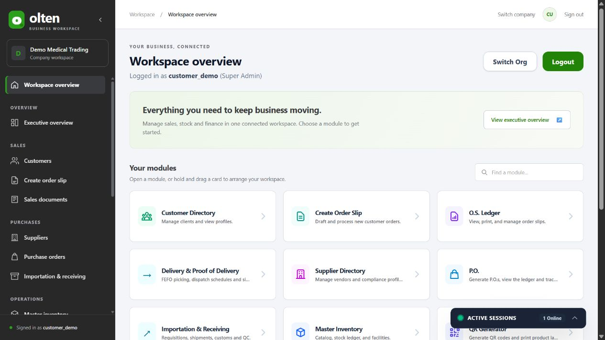

# ERP transformation: implementation and verification

**Continuation:** The subsequently approved allocation, memo, financial statements, cash-flow, posting-role and inventory reconciliation packages are now implemented and tested. See [completion verification](completion-verification.md) for current results, file manifest and release/rollback plan. The historical observations below describe the earlier commits.

Completed approved scope: October 26, 2026, Asia/Manila. Branch: `codex/erp-ui-accounting-audit`. Baseline: `8eb736acd32922c1d93e4d398da3266eefc9e443`.

The non-payroll workspace now uses a QuickBooks-inspired charcoal, green and neutral palette, with collapsible desktop navigation, a mobile menu, company context, module search and compact forms/tables. Existing workflows remain in their modules. No production database, deployment configuration or credentials were changed. This report records defined test evidence and open limitations; it does not certify accounting accuracy or regulatory compliance.

## Delivered interface changes

- A shared, opt-in screen shell connects the existing modules and permission-filtered navigation. The module gateway retains its saved drag order; search understands the card names, navigation names and abbreviations such as P.O., QR Generator and O.S. Ledger.
- Primary actions use green `#218409`, navigation uses charcoal `#282828`, with white panels and light-neutral surfaces. White primary-action text meets 4.5:1 contrast. Existing status/error colors remain distinguishable. Olten branding is retained.
- Non-payroll tables, forms, focus indicators, spacing and screen typography are consistent. Existing print content is preserved; navigation hides on print. Reduced-motion preferences are respected.
- Finance and Books have searchable loaded records, compact source tables, clear loading/error/empty states and an existing-journal history view. Search does not alter the source dataset or exports. The history view explicitly describes its loaded-record limit.
- The Executive screen uses existing backend alert and demand results; the demand chart does not fabricate projections when history or permission is insufficient. Existing management reports remain accessible.
- Direct Warehouse → Delivery navigation opens the requested tab. Customer panes fit the space below the shell header on desktop and mobile, with their existing inner scrolling retained.
- The dedicated Document workspace keeps its full-width layout and original Gateway/upload lock. Payroll remains completely outside the new shell and scoped CSS.

Screenshots show **synthetic data in a separate local test database**:



| Screen | Evidence |
| --- | --- |
| Books and trial balance | [Books screenshot](../../output/erp-transformation/books.jpg) |
| Finance | [Finance screenshot](../../output/erp-transformation/finance.jpg) |
| Executive overview | [Executive screenshot](../../output/erp-transformation/executive.jpg) |
| Mobile workspace/navigation | [Workspace](../../output/erp-transformation/mobile-workspace.jpg), [open menu](../../output/erp-transformation/mobile-navigation.jpg) |
| Original payroll UI and saved payslip | [Payroll](../../output/erp-transformation/payroll-unchanged.jpg), [payslip](../../output/erp-transformation/saved-payroll.jpg) |
| Dedicated documents and its isolated connection error | [Document workspace](../../output/erp-transformation/documents.jpg) |

## Approved behavior changes

The user explicitly approved each detailed proposal before implementation:

| Proposal | Implemented behavior | Preserved boundary |
| --- | --- | --- |
| SEC-A | Existing session, payroll module, assigned company and employee/payroll/attendance ownership are required; matching client headers and scoped source queries were added. | Payroll formulas, attendance rules, UI, snapshots, saved amounts and schema remain unchanged. Existing duplicate admin routes use the existing admin guard. |
| SEC-B | Legacy catalog, warehouse, sales and purchasing endpoints require the existing session, module and company access; IDs and existing referenced records are company checked. | Existing catalog-read, tier-price and stock-placement dependencies are retained. No pricing, VAT-rate, reservation, numbering or stock-issue policy changed by the permission rollout. |
| A-RND | OS/FO and manual PO line/subtotal/VAT calculations use decimal half-up cents; OS/PO previews match. | No automatic historical recalculation, no payroll rounding change, no QT calculation change, no schema migration. Explicit OS updates calculate their changed totals under the approved rule. |

The real-database concurrency audit also exposed a technical response defect: raw serialization/deadlock errors escaped as HTTP 500. They now use the existing conflict response, with no automatic retry or additional posting. Unrelated database errors still propagate.

Example tested through the authenticated API and persisted PostgreSQL rows: `1 × 1.005` produces subtotal **1.01**, VAT **0.12**, total **1.13**. Creating those OS/PO documents leaves physical stock unchanged. Existing required source-OS validation for POs remains intact.

## Executed verification

Commands below ran from the named directory, using existing dependencies. Local output logs are under `backend/.tmp/erp-transformation/`; that temporary directory is not committed.

| Directory | Command | Observed final result |
| --- | --- | --- |
| backend | `node --max-old-space-size=4096 node_modules/jest/bin/jest.js --runInBand` | **47 suites, 1,285 tests passed**, no skipped tests. Baseline was 45 suites / 1,187 tests. |
| backend | `node --max-old-space-size=4096 node_modules/jest/bin/jest.js --runInBand --testRegex 'legacy-security.audit-spec.ts\|accounting.audit-spec.ts'` | **2 suites, 22 tests passed**: security12, accounting10. Original failing assertions are retained. |
| backend | `npm run build` | Passed. |
| frontend | `node --test tests/*.test.mjs` | **46 passed**, zero failures/skips. Includes transport, decimal previews, baseline hashes, presentation, shell and module-search tests. |
| frontend | `npx tsc -b` | Passed. |
| frontend | `npm run build` | Passed. Existing large-chunk warning remains; final build also reports plugin timing information. |
| backend | `node --max-old-space-size=4096 node_modules/eslint/bin/eslint.js src/auth/legacy-erp-auth.guard.ts src/auth/legacy-erp-auth.guard.spec.ts src/auth/payroll-auth.guard.ts src/auth/payroll-auth.guard.spec.ts` | Passed. An initial run with the default heap exhausted memory; rerunning with 4GB passed. |
| backend | `node --max-old-space-size=4096 node_modules/eslint/bin/eslint.js src/auth/legacy-security.audit-spec.ts src/phase3/accounting.audit-spec.ts` | Passed. |
| frontend | `node --max-old-space-size=4096 node_modules/eslint/bin/eslint.js src/components/ErpShell.tsx src/lib/workspaceNavigation.ts src/lib/salesAmounts.ts src/modules/phase3/*.tsx src/modules/phase3/api.ts src/modules/Phase3Module.tsx` | Passed. |
| frontend | `node --max-old-space-size=4096 node_modules/eslint/bin/eslint.js . --format json --output-file ../backend/.tmp/erp-transformation/frontend-lint-complete.json` | **Fails on existing issues.** Source errors decreased240→238; warnings remain7, with no new source-file violations. The broader command also includes3 errors in an existing ignored `phase2-sales.local` harness absent from the initial lint snapshot, so whole-tree total is241 errors. |
| backend | `npx tsc --noEmit` | Fails on3 existing test-configuration/type errors: the intentional invalid-account-type fixture in `phase3.shared.spec.ts:259`, plus2 NodeNext extension errors in protected `frontend/src/lib/attendanceEntry.ts`. Production Nest build and frontend type check pass. |
| repository | `git diff --check` | Passed; Git prints normal LF/CRLF conversion notices. |

No broad automatic lint fixes, weakened assertions or skipped failures were used. Test coverage percentage was not measured and is not inferred from passing test counts.

### Actual HTTP and PostgreSQL tests

Committed, explicitly invoked integration harnesses:

```powershell
# From D:\olten\backend, with the separate test DB and isolated API already running:
node test/erp-transformation/legacy-auth.integration.cjs
node test/erp-transformation/accounting.integration.cjs
```

These scripts intentionally target only loopback PostgreSQL port55439, database `customer_guide_20261023b`, and verify `current_database()` before creating new timestamped synthetic companies. They never read production `DATABASE_URL` for their connection, reset/drop/truncate tables or clean up existing records. The API test requires the isolated API on loopback port3105 backed by that same DB; otherwise its synthetic login fails. The schema and Phase3 triggers must already be installed. Do not point these tests at a production server. They are separate from ordinary mocked Jest tests because they write synthetic fixtures.

- **HTTP/API integration:41 scenarios passed.** Tests cover unauthenticated reads, company/header mismatch, unassigned companies, omitted scope, foreign IDs/references, legitimate catalog/tier/PO-status dependencies, authenticated OS/PO persisted half-cent totals, trusted actor attribution and unchanged physical stock.
- **PostgreSQL accounting integration:15 passing groups,1 failed requirement; exit1 intentionally retained.** Five installed triggers, concurrent invoice/payment uniqueness, atomic rollback, FKs, exact balancing, append-only protections, AR/AP and bank reconciliation were exercised against real PostgreSQL.
- Independent synthetic source/ledger expectations: AR `112−40=72`; AP `70+30+12−20=92`; trial debits **334** equal credits **334**; bank closing **20**. This limited fixture's equation and ledger sources reconcile.
- The remaining failure is **A-DB**: a direct SQL allocation can link parents from different companies despite API validation. The probe forces rollback and confirms no bad allocation persisted. No migration was applied to conceal the failure.

### Browser verification

Test browser: local Vite port5175 → isolated Nest API3105 → separate PostgreSQL55439. Cloud Drive/OAuth and Gemini credentials were deliberately unset in this API process to prevent external side effects. No live customer/employee data was used.

Read-only screen checks covered Customers, Suppliers, Master Inventory, Create Order Slip, O.S. Ledger, P.O., Importation/Receiving, Warehouse, Delivery/POD, QR labels, service, AI, Books, Finance and Executive. Books account search and Finance invoice search filtered loaded records correctly. The final module-alias search was verified with P.O. Desktop navigation collapse/expand and mobile open/select/close worked.

At viewport390×844, the closed sidebar is hidden from the accessibility tree and customer panes measure789px below the55px header. At the normal720px viewport height, those panes measure659px below the61px header. The document workspace opens independently; its cloud connection error is expected with isolated credentials. Successful external Drive, OCR and Gemini operations were **not** verified.

Payroll's DOM contains no `.erp-modern` wrapper. Its original dashboard, employee records, saved history and saved payslip loaded through the approved transport. No payroll/attendance record was saved or recalculated in browser verification. Normal regression tests retain existing calculations, including midnight sessions, daily/cutoff overtime and payroll/tax boundaries.

## Remaining risks and deliberately unsupported requests

The implementation is reviewable, but the requested full accounting transformation is **not a certification or completion of the following unapproved business features**:

1. **A-DB:** database-level company equality for allocations needs historical validation and a specifically approved migration/rollback plan.
2. **A-INT/A-VAL:** operational stock receipts, adjustments and landed-cost references do not automatically capitalize Inventory in Books. The valuation report is a current **warehouse reference valuation**, excludes office stock and is not historical FIFO/weighted-average valuation.
3. **A-MEM:** financial memos need an approved submission replay key to distinguish retries from intentional identical adjustments.
4. **A-MAP:** stored reference mappings do not drive existing fixed-code postings. Changing the posting strategy requires an approved account policy.
5. **A-RPT:** full fiscal P&L, Balance Sheet, Cash Flow, as-of balances and revenue/expense trends need approved backend definitions and opening/closing/classification rules. The UI does not label sales margin as net profit or invent missing figures.
6. **A-TAX:** entity-specific VAT-exempt/zero-rated/inclusive/EWT and statutory invoice requirements need a qualified Philippine accountant's confirmation. No tax registration or compliance claim is made.
7. Legacy Float fields, two-decimal OS unit-price storage, report limits, separate legacy balances, history deletion policies and the QR client-password policy remain documented limitations. This work did not silently redesign them.

The detailed findings, numerical examples, impact and approval/rollback proposals are in [accounting audit](accounting-audit.md) and [baseline/security audit](baseline-and-security.md). Unsupported business logic was not added merely to make every dashboard card or audit result green.

## Release and rollback

Implementation commit `eff9cc9` was pushed to `origin/codex/erp-ui-accounting-audit`. No production merge or migration was performed. Deploy frontend and backend from the same reviewed revision when the release is approved, because the newly authenticated APIs require the updated client headers. Production needs a stable existing session secret shared between instances; this task did not inspect or change its value.

Rollback is a code revert to the reviewed baseline; there is no database migration or automatic historical recalculation to undo. Reverting the access guards reopens the documented vulnerabilities, so prefer a forward fix for authentication incidents. Do not delete posted records or recalculate saved payroll to roll back this UI/security change.

## Files touched

The manifest below is generated from this task's reviewed source/test/document changes. Pre-existing `.agents` deletions, root `AGENTS.md`, older guides and unrelated output are excluded.

- `backend/src/auth/legacy-erp-auth.guard.spec.ts`
- `backend/src/auth/legacy-erp-auth.guard.ts`
- `backend/src/auth/legacy-security.audit-spec.ts`
- `backend/src/auth/payroll-auth.guard.spec.ts`
- `backend/src/auth/payroll-auth.guard.ts`
- `backend/src/employees/employees-attendance.spec.ts`
- `backend/src/employees/employees.controller.spec.ts`
- `backend/src/employees/employees.controller.ts`
- `backend/src/employees/employees.module.ts`
- `backend/src/employees/employees.service.ts`
- `backend/src/master-inventory/master-inventory.controller.ts`
- `backend/src/phase3/accounting.audit-spec.ts`
- `backend/src/phase3/finance.service.spec.ts`
- `backend/src/phase3/finance.service.ts`
- `backend/src/sales/order-slips.controller.ts`
- `backend/src/sales/packing-lists.controller.ts`
- `backend/src/sales/purchase-orders.controller.ts`
- `backend/src/sales/quotations.controller.ts`
- `backend/src/sales/sales-fulfillment.spec.ts`
- `backend/src/sales/sales.controller.ts`
- `backend/src/settings/settings.controller.ts`
- `backend/test/erp-transformation/accounting.integration.cjs`
- `backend/test/erp-transformation/legacy-auth.integration.cjs`
- `docs/erp-transformation/accounting-audit.md`
- `docs/erp-transformation/baseline-and-security.md`
- `docs/erp-transformation/implementation-and-verification.md`
- `frontend/src/App.tsx`
- `frontend/src/components/ErpShell.tsx`
- `frontend/src/erp.css`
- `frontend/src/lib/salesAmounts.ts`
- `frontend/src/lib/workspaceNavigation.ts`
- `frontend/src/modules/CompanyModule.tsx`
- `frontend/src/modules/CreateOSModule.tsx`
- `frontend/src/modules/CustomerModule.tsx`
- `frontend/src/modules/MasterInventory.tsx`
- `frontend/src/modules/OrderSlipsModule.tsx`
- `frontend/src/modules/PayrollModule.tsx`
- `frontend/src/modules/Phase3Module.tsx`
- `frontend/src/modules/ProductQRModule.tsx`
- `frontend/src/modules/PurchaseOrdersModule.tsx`
- `frontend/src/modules/SalesOrderModule.tsx`
- `frontend/src/modules/SupplierModule.tsx`
- `frontend/src/modules/phase3/BooksWorkspace.tsx`
- `frontend/src/modules/phase3/FinanceWorkspace.tsx`
- `frontend/src/modules/phase3/InsightsWorkspace.tsx`
- `frontend/src/modules/phase3/api.ts`
- `frontend/src/modules/phase3/shared.tsx`
- `frontend/src/modules/phase3/workspace.css`
- `frontend/tests/erp-shell.test.mjs`
- `frontend/tests/fixtures/payroll-protected-hashes.json`
- `frontend/tests/legacy-api-transport.test.mjs`
- `frontend/tests/phase3-presentation.test.mjs`
- `frontend/tests/sales-amounts.test.mjs`
- `frontend/tests/workspace-navigation.test.mjs`

Nine screenshot files listed in the evidence table are included separately. Other exploratory screenshots and all older output remain outside this commit.
